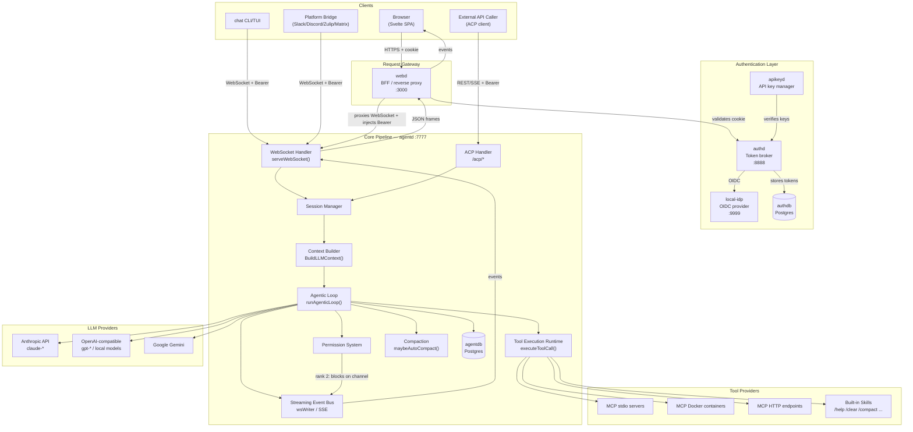
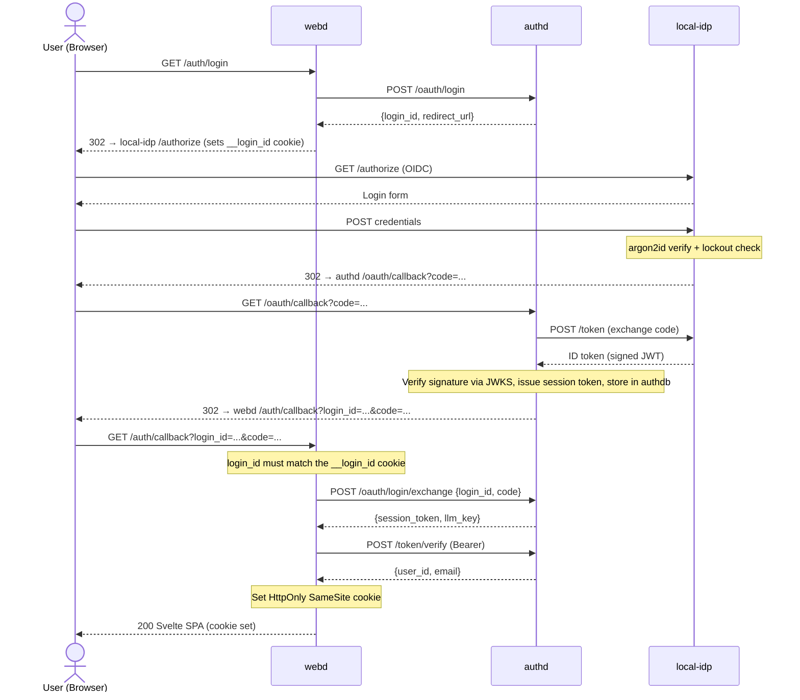
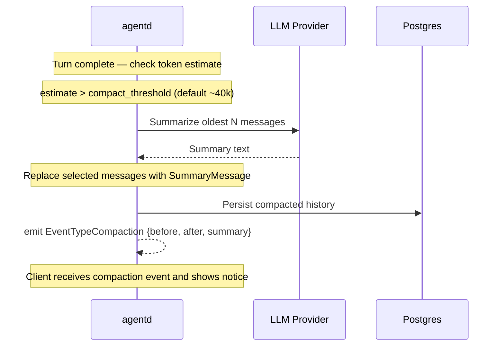
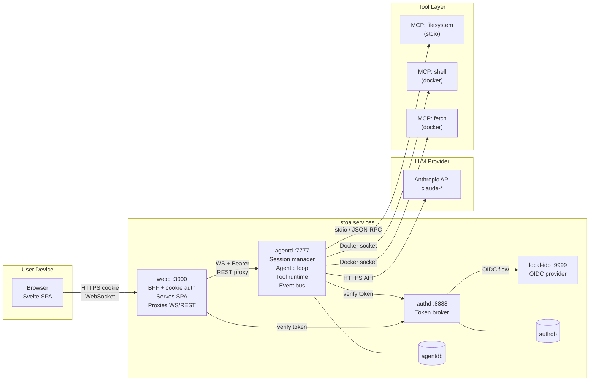
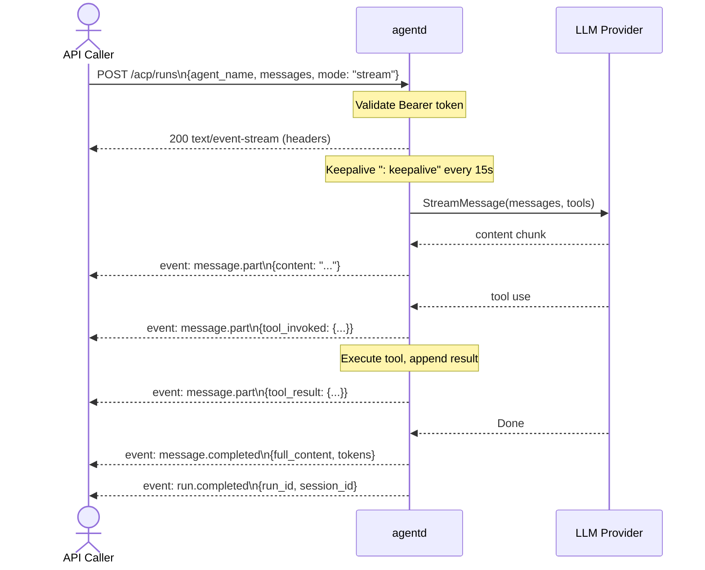
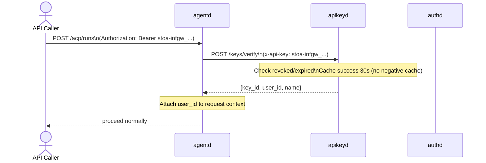
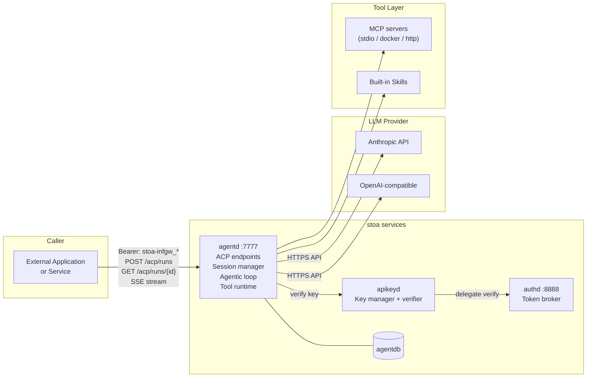
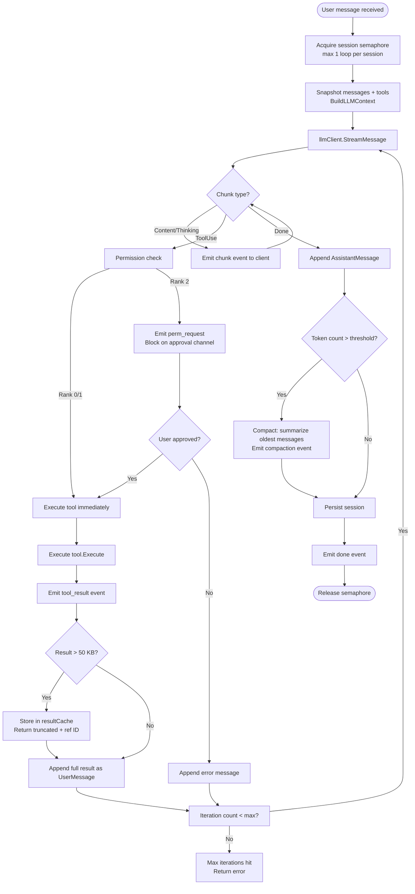

# LLM Pipeline Architecture

This document describes the components necessary to build production LLM pipelines and shows how they fit together in two primary use cases drawn from this codebase: the **hosted chat interface** and **raw API access**.

---

## 1. Foundational Pipeline Components

Every LLM pipeline, regardless of use case, shares the same set of core concerns. The sections below describe each component conceptually, then show how this codebase implements it.

### 1.1 Client / Entry Point

The surface through which a user or external system delivers input to the pipeline. A client can be a web browser, a CLI/TUI, an API integration, or a chat-platform bridge (Slack, Discord, Zulip, Matrix).

| Concern | This Codebase |
|---------|---------------|
| Web UI | Svelte SPA served by `webd` |
| Terminal | `chat` binary in standalone or remote mode |
| Platform bridges | `cmd/zulip-bridge`, `cmd/slack-bridge`, `cmd/discord-bridge`, `cmd/matrix-bridge` |
| Machine API | ACP (`/acp/*`) endpoints on `agentd` |

---

### 1.2 Authentication & Authorization Layer

Verifies identity (**authn**) and enforces access control (**authz**). In multi-tenant systems this also isolates sessions and data between users.

| Concern | This Codebase |
|---------|---------------|
| Identity provider | `local-idp` — username/password, argon2id hashing, account lockout |
| Token broker | `authd` — issues and verifies HMAC-signed session tokens via OIDC |
| Token storage | `authdb` (Postgres) — active session records |
| API key management | `apikeyd` — issues `stoa-infgw_*` keys; 30 s positive cache, no negative cache |
| agentd validation priority | (1) `authd.VerifyToken`, (2) local DB, (3) `AGENTD_API_KEY` constant |

---

### 1.3 Request Gateway / Backend-for-Frontend

Stands between the client and the LLM backend. Translates credentials (cookies → Bearer tokens), enforces CORS and same-site policies, and shields LLM credentials from browser exposure.

| Concern | This Codebase |
|---------|---------------|
| Component | `webd` on port 3000 |
| Cookie handling | Sets `HttpOnly SameSite=Strict` session cookie; browser never sees raw token |
| Proxy | Forwards REST and WebSocket traffic to `agentd`; injects `Authorization: Bearer` |

---

### 1.4 Session Manager

Maintains the state of a single conversation: message history, active tools, user identity, sub-agents, and per-session configuration. The session is the unit of a conversation.

```
Session {
    id            string
    messages      []chat.Message           // full conversation history
    llmCtx        app.LLMContext           // coherent {SystemPrompt, Tools[]}
    permPending   map[string]chan bool      // requestID → approval channel
    perSessionTools map[string]Tool        // spawn_agent, message_agent, etc.
    resultCache   map[string]string        // paginated large tool results
    overrides     *llm.Overrides           // per-session provider/model override
    subAgents     map[string]*SubAgent
    tracer        *trace.Tracer            // JSONL conversation log
}
```

*Source: `internal/agentd/session.go`*

---

### 1.5 Context Builder

Assembles the complete prompt submitted to the LLM: system prompt, filtered tool list, and conversation history. Applies persona rules, removes messages not meant for the LLM (system notes, summary placeholders), and validates that the sequence ends with a user message.

| Concern | This Codebase |
|---------|---------------|
| Context assembly | `internal/app/llm.go:BuildLLMContext()` |
| Message filtering | Strip system/summary messages; validate sequence |
| Compaction placeholder | Removes the empty streaming placeholder before sending |

---

### 1.6 LLM Provider Client

Translates the internal message and tool representation into provider-specific API calls, then maps streaming chunks back to a canonical `StreamChunk` format understood by the rest of the system.

```
StreamChunk {
    Content      string    // incremental text delta
    Thinking     string    // reasoning delta (model-dependent)
    ToolUse      *ToolUse  // structured tool invocation request
    Done         bool
    InputTokens  int       // populated on Done chunk
    OutputTokens int
    Error        error
}
```

*Source: `internal/llm/client.go`*

| Provider | Implementation | Notes |
|----------|---------------|-------|
| Anthropic | `internal/llm/anthropic.go` | Native streaming, `thinking_delta`, prompt caching |
| OpenAI-compatible | `internal/llm/openai.go` | Works with Together, Groq, Ollama, vLLM, etc. |
| Gemini | `internal/llm/gemini.go` | Google-specific variant |

Provider selection follows: per-session override → config default → fallback chain on retryable error.

---

### 1.7 Streaming Event Bus

Propagates real-time LLM output from the backend to the client. Uses WebSocket for the TUI and web UI, and SSE for ACP (machine API) callers.

| Event | Payload | Client Action |
|-------|---------|---------------|
| `chunk` | `{Content, Thinking}` | Append to streaming message |
| `tool_invoked` | `{ToolName, ToolUseID, Params, RequiresPermission}` | Show tool call inline |
| `tool_result` | `{ToolName, Result, IsError}` | Append result |
| `perm_request` | `{RequestID, ToolName, Params}` | Show approval modal |
| `perm_mention` | `{ToolName, Description}` | Show silent mention |
| `done` | `{FullContent, InputTokens, OutputTokens}` | Finalize message |
| `compaction` | `{MessagesBefore, MessagesAfter, Summary}` | Show compaction notice |
| `error` | `{Message, Fatal}` | Show error; close session if fatal |

*Source: `internal/agentproto/events.go`*

---

### 1.8 Tool Execution Runtime

Receives tool-use requests from the LLM, resolves the tool implementation (built-in or MCP adapter), executes it, and returns the result as a new user message in the conversation so the LLM can continue.

**Resolution order:**

```
1. sess.perSessionTools[name]       // spawn_agent, message_agent, etc.
2. skillRegistry.GetTool(name)      // built-ins + MCP adapters
3. Error: tool not found
```

Results exceeding 50 KB are stored in `sess.resultCache` and the LLM receives a truncated summary with a `read_tool_result` reference — preventing context window bloat from large tool outputs.

*Source: `internal/agentd/loop.go:executeToolCall()`*

---

### 1.9 Permission System

Determines whether a tool execution is silently approved, acknowledged, or requires explicit user approval before proceeding.

| Rank | Behavior | When |
|------|----------|------|
| 0 — Silent | Execute immediately, no notification | Internal system tools |
| 1 — Mention | Execute immediately, emit `perm_mention` event | Most MCP reads |
| 2 — Request | Block until user sends `perm_response`; emit `perm_request` event | Shell, file writes, sensitive operations |

When rank is Request, the agentic loop pauses at a Go channel (`sess.permPending[requestID]`) until the client sends `{ "type": "perm_response", "perm_response": { "request_id": "...", "approved": true } }`.

*Source: `internal/permissions/permissions.go`*

---

### 1.10 Compaction / History Management

Prevents context window exhaustion. After each turn, the estimated token count is checked against `compaction.compact_threshold`. If exceeded, the oldest messages are summarized by a separate LLM call and replaced with a single summary message. The client receives a `compaction` event with before/after counts and the generated summary text.

*Source: `internal/agentd/handlers.go:maybeAutoCompact()`, `internal/compaction/compactor.go`*

---

### 1.11 Tool Providers (MCP)

External tool servers that extend the LLM's capabilities. Discovered asynchronously at startup; sessions created during the discovery window receive a reduced tool list that is upgraded automatically once discovery completes.

| Transport | Mechanism |
|-----------|-----------|
| `stdio` | Spawns subprocess; JSON-RPC over stdin/stdout |
| `docker` | Runs container via Docker/Podman socket; attaches stdio |
| `http` | Direct HTTP to external MCP endpoint |

Docker containers run on isolated networks and route outbound traffic through a Squid proxy allowlist.

*Source: `internal/app/mcp.go`, `internal/mcp/`*

---

### 1.12 Persistence Layer

Durably stores sessions and message history so conversations survive restarts.

| Mode | Mechanism |
|------|-----------|
| In-memory | Default; sessions lost on restart |
| Filesystem | `AGENTD_SESSION_DIR`: one JSON file per session |
| Postgres | `AGENTD_DATABASE_URL`: `sessions` + `messages` tables; incremental writes per turn |

---

## 2. Component Dependency Map

This diagram shows every component and how they relate across all use cases.



---

## 3. Hosted Chat Interface Pipeline

### 3.1 Overview

The hosted chat path runs: **Browser → webd → agentd → LLM**. The browser never holds LLM credentials or a session token — `webd` mediates everything behind an HttpOnly cookie. `agentd` owns session state, executes tools, and streams events back through `webd` to the browser in real time.

### 3.2 Login Flow



### 3.3 LLM Request & Streaming Response

```mermaid
sequenceDiagram
    actor User as User (Browser)
    participant webd
    participant agentd
    participant llm as LLM Provider
    participant mcp as MCP Tool

    User->>webd: WS /ws/:sessionId (cookie)
    webd->>agentd: WS /sessions/:id/ws (injects Bearer)

    User->>webd: send_message {content}
    webd->>agentd: forward ClientMessage JSON

    Note over agentd: Acquire agentSem (max 1 loop/session)
    Note over agentd: BuildLLMContext() → system prompt + filtered tool list
    Note over agentd: Filter messages (strip system/summary/placeholder)

    agentd->>llm: StreamMessage(messages, tools)
    llm-->>agentd: chunk: Content delta
    agentd-->>webd: event: chunk {Content}
    webd-->>User: render text incrementally

    llm-->>agentd: chunk: ToolUse {name, params}
    Note over agentd: Permission check (rank 0/1/2)

    alt Rank 2 — requires approval
        agentd-->>webd: event: perm_request {requestID, toolName, params}
        webd-->>User: show approval modal
        User->>webd: perm_response {requestID, approved: true}
        webd->>agentd: forward perm_response
    end

    agentd-->>webd: event: tool_invoked {toolName, params}
    webd-->>User: show tool call inline

    agentd->>mcp: tool.Execute(params)
    mcp-->>agentd: ToolResult {content}

    agentd-->>webd: event: tool_result {result}
    webd-->>User: show result

    Note over agentd: Append tool result as UserMessage, continue loop

    agentd->>llm: StreamMessage(messages + tool result, tools)
    llm-->>agentd: chunk: Content delta (final answer)
    agentd-->>webd: event: chunk {Content}
    webd-->>User: render final text

    llm-->>agentd: Done {InputTokens, OutputTokens}
    Note over agentd: Append AssistantMessage; maybeAutoCompact(); persist to DB
    agentd-->>webd: event: done {fullContent, tokens}
    webd-->>User: finalize message display
```

### 3.4 Compaction Flow

When the conversation history grows past the token threshold, compaction runs transparently after a turn completes.



### 3.5 Full System Topology — Hosted Chat



---

## 4. Raw API Pipeline

### 4.1 Overview

The raw API path bypasses `webd` entirely. An external caller interacts directly with `agentd`'s ACP (Agent Control Protocol) endpoints using a Bearer token (from `authd` or `apikeyd`). This path supports three modes:

| Mode | Behavior | Use case |
|------|----------|----------|
| `sync` | Block until the full response is ready; return JSON | Simple integrations, scripting |
| `async` | Return `run_id` immediately; caller polls `GET /acp/runs/{id}` | Long-running tasks, fire-and-forget |
| `stream` | Return SSE stream; events mirror the WebSocket event types | Real-time integrations |

Permission requests in this mode are handled via `POST /acp/runs/{id}` with an approval payload, equivalent to the WebSocket `perm_response`.

### 4.2 Sync / Async Run Flow

```mermaid
sequenceDiagram
    actor Caller as API Caller
    participant agentd
    participant llm as LLM Provider
    participant mcp as MCP Tool

    Caller->>agentd: POST /acp/runs\n{agent_name, messages, mode: "async"}
    Note over agentd: Validate Bearer token\nResolve agent → Session + LLMContext
    agentd-->>Caller: 202 {run_id}

    Note over agentd: runAgenticLoop() in background goroutine

    agentd->>llm: StreamMessage(messages, tools)
    llm-->>agentd: streaming chunks

    opt Tool use
        agentd->>mcp: tool.Execute(params)
        mcp-->>agentd: result
        Note over agentd: Append result, continue loop
    end

    opt Permission required (rank 2)
        Note over agentd: Pause loop; run status = "awaiting_input"
        Caller->>agentd: GET /acp/runs/{id}
        agentd-->>Caller: {status: "awaiting_input", perm_request: {...}}
        Caller->>agentd: POST /acp/runs/{id}\n{perm_response: {approved: true}}
        Note over agentd: Resume loop
    end

    Note over agentd: Turn complete; persist session
    Note over agentd: Run store: status = "completed"

    Caller->>agentd: GET /acp/runs/{id}
    agentd-->>Caller: 200 {status: "completed", output: {content, tokens}}
```

### 4.3 Streaming (SSE) Run Flow



### 4.4 API Key Authentication Flow

For machine-to-machine access, callers use `apikeyd` keys instead of session tokens.



### 4.5 Full System Topology — Raw API



---

## 5. Side-by-Side Comparison

| Concern | Hosted Chat | Raw API |
|---------|-------------|---------|
| **Entry point** | Browser (Svelte SPA) | External application |
| **Auth credential** | HttpOnly session cookie | Bearer token (`authd` or `apikeyd`) |
| **Gateway** | `webd` (cookie → token injection) | Direct to `agentd` |
| **Transport** | WebSocket (bidirectional, real-time) | REST + SSE or polling |
| **Event delivery** | WebSocket JSON frames | SSE (`text/event-stream`) or poll |
| **Permission UX** | Modal in web UI; `perm_response` over WS | `POST /acp/runs/{id}` with approval |
| **Session lifecycle** | Browser manages via `webd` | Caller manages `session_id` across runs |
| **Multi-turn** | Implicit (WebSocket stays open) | Explicit `session_id` on each run |
| **LLM credentials** | Held by `agentd`; never exposed | Held by `agentd`; never exposed |
| **Tool execution** | Same | Same |
| **Compaction** | Transparent; client gets `compaction` event | Transparent; SSE or next poll response |

---

## 6. Agentic Loop — Internal Detail

Both pipelines share the same core loop inside `agentd`. The only difference is how messages arrive and how events are delivered.



---

## 7. Key Source Locations

| Component | File |
|-----------|------|
| Agentic loop | `internal/agentd/loop.go` |
| Tool execution | `internal/agentd/loop.go:executeToolCall()` |
| WebSocket handler | `internal/agentd/handlers.go:serveWebSocket()` |
| ACP handlers | `internal/agentd/handlers_acp.go` |
| Session struct | `internal/agentd/session.go` |
| LLM context builder | `internal/app/llm.go:BuildLLMContext()` |
| Anthropic provider | `internal/llm/anthropic.go` |
| OpenAI provider | `internal/llm/openai.go` |
| Permission system | `internal/permissions/permissions.go` |
| Compaction | `internal/compaction/compactor.go` |
| MCP setup | `internal/app/mcp.go` |
| Auth middleware | `internal/agentd/auth.go` |
| Config loading | `internal/config/config.go:Load()` |
| Protocol types | `internal/agentproto/events.go`, `internal/agentproto/messages.go` |
| webd server | `internal/webd/server.go` |
